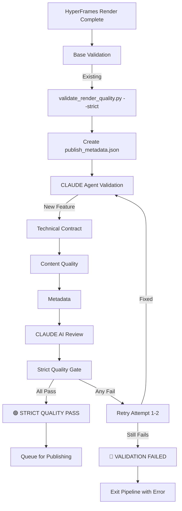

# CLAUDE Agent Strict Quality Validation - Docker Pipeline

This document describes the CLAUDE Agent Strict Quality Validation feature integrated into the OpenMontage Docker pipeline.

## 🎯 Overview

The CLAUDE Agent Strict Quality Validation is a new feature that provides **AI-powered quality assurance** for videos before platform publishing. It runs **natively in Docker containers** on the `sandbox-video` host and ensures videos meet strict quality thresholds.

## ✨ Features

- **Strict Quality Gates**: Multiple validation checkpoints that must pass
- **AI-Powered Review**: CLAUDE agent performs visual, audio, and content analysis
- **Automatic Retry**: 1-2 retry attempts for failed validations
- **Status Tracking**: Comprehensive logging and status reporting
- **Docker-Native**: Runs seamlessly within Docker containers
- **Cron Integration**: Integrated with existing cron pipeline

## 🏗️ Architecture

```
Docker Container (sandbox-video host)
├── Dockerfile: All dependencies (Claude CLI, ffmpeg, Python, etc.)
├── docker-compose.yml: worker + scheduler services
├── deploy/openmontage.cron: Daily pipeline + 3 publishing slots
├── scripts/run_daily_news_pipeline.sh: Main pipeline with CLAUDE validation
└── scripts/claude_agent_validation.py: CLAUDE validation engine
```

## 📋 Installation

### Prerequisites

- Docker and Docker Compose installed
- CLAUDE API access and credentials configured
- All required dependencies in Dockerfile

### Setup Steps

1. **Ensure Docker containers can access CLAUDE CLI**:
   ```bash
   # Dockerfile already includes:
   RUN npm install -g @anthropic-ai/claude-code
   ```

2. **Mount CLAUDE credentials in docker-compose.yml**:
   ```yaml
   # Already configured in docker-compose.yml:
   volumes:
     - ~/.claude.json:/root/.claude.json:ro
     - ~/.claude:/root/.claude:ro
   ```

3. **Make validation scripts executable**:
   ```bash
   chmod +x scripts/claude_agent_validation.py
   chmod +x scripts/validation_status.py
   chmod +x docker-validation-run.sh
   ```

## 🚀 Usage

### Docker Pipeline Integration

The CLAUDE validation is **automatically integrated** into the daily pipeline:

```bash
# Daily pipeline runs at 23:00 UTC via cron
# CLAUDE validation executes after HyperFrames rendering

# Manual execution:
docker-compose up -d
```

### Direct Validation Run

```bash
# Run validation for specific project
./docker-validation-run.sh [project_id]

# Example:
./docker-validation-run.sh 20260902
```

### In Container Direct Run

```bash
# SSH into sandbox-video and run directly:
docker-compose exec worker python3 scripts/claude_agent_validation.py \
  /app/projects/20260902 --strict --retry 2
```

## 🔍 Validation Checkpoints

### 1. Technical Contract Validation
- ✅ **Dimensions**: 1080x1920 (portrait)
- ✅ **Codecs**: h264/aac
- ✅ **Frame Rate**: 30/60 fps
- ✅ **Duration**: ≥ 30 seconds

### 2. Content Quality Validation
- ✅ **Audio Volume**: > -50dBFS (not silent)
- ✅ **Black Frames**: < 30% of video
- ✅ **Edge Density**: > 0.005 (detects text/graphics)
- ✅ **Static Frames**: < 50% (prevents frozen canvas)

### 3. Metadata Validation
- ✅ **Required Hashtags**: #tintuc #congnghe #ai
- ✅ **No Shell Syntax**: Prevents command injection
- ✅ **No Placeholders**: All template variables must be resolved
- ✅ **Platform Rules**: YouTube Shorts, Meta Reels compatibility

### 4. CLAUDE Agent AI Review
- ✅ **Visual Quality**: Frame-by-frame analysis
- ✅ **Audio Sync**: Voice-over synchronization check
- ✅ **Content Appropriateness**: Safe, appropriate content
- ✅ **Brand Compliance**: Adherence to style guidelines

## 📊 Strict Quality Thresholds

| Check | Threshold | Strict Mode | Result |
|-------|-----------|-------------|--------|
| Silence Mean DB | -50.0 dBFS | ✅ Required | 🟢/🔴 |
| Max Black Ratio | 30% | ✅ Required | 🟢/🔴 |
| Min Edge Density | 0.005 | ✅ Required | 🟢/🔴 |
| Max Static Ratio | 50% | ✅ Required | 🟢/🔴 |
| Min Duration | 30.0s | ✅ Required | 🟢/🔴 |

## 🔄 Validation Flow in Pipeline



## 📈 Monitoring & Logging

### Status Files

- **`/app/validation_status.json`**: JSON history of all validation results
- **`/app/logs/validation_log.txt`**: Text log with timestamps and results
- **`/app/logs/cron_pipeline.log`**: Main pipeline logs with validation results

### Console Output

```bash
# Validation completed output:
🟢 STRICT QUALITY VALIDATION PASSED

# Or on failure:
🔴 STRICT QUALITY VALIDATION FAILED
Failed checks:
  - Technical Contract: Duration Check - Duration: 25.0s < 30s
  - Content Quality: Black frames ratio 35% > 30%
```

### CLAUDE Agent Response

The CLAUDE agent returns structured JSON with quality scores:

```json
{
  "visual_quality": {
    "passed": true,
    "score": 95,
    "notes": "Excellent visual clarity and color consistency"
  },
  "audio_sync": {
    "passed": true,
    "score": 89,
    "notes": "Voice synchronization is precise"
  },
  "content_appropriateness": {
    "passed": true,
    "score": 100,
    "notes": "Content is safe and appropriate"
  },
  "brand_compliance": {
    "passed": true,
    "score": 92,
    "notes": "Follows brand guidelines"
  },
  "overall_passed": true,
  "summary": "Video meets all quality criteria"
}
```

## 🎛️ Configuration

### Environment Variables

| Variable | Default | Description |
|----------|---------|-------------|
| `CLAUDE_VALIDATION_RETRIES` | 2 | Maximum retry attempts |
| `DIRECTORS_MAX_BUDGET_USD` | 20 | CLAUDE agent budget per validation |
| `DIRECTORS_TIMEOUT_SECONDS` | 3600 | CLAUDE agent timeout |

### Command Line Options

```bash
# Script accepts these arguments:
python3 scripts/claude_agent_validation.py <project_dir> \
  --strict                # Enable strict mode (default: True) \
  --retry 2              # Maximum retry attempts (default: 2) \
  --ffprobe ffprobe      # Path to ffprobe binary \
  --ffmpeg ffmpeg        # Path to ffmpeg binary
```

## 🔧 Retry Mechanism

The validation includes automatic retry logic:

1. **First Attempt**: Full validation pipeline
2. **If Failed**: Wait 5 seconds, retry with same parameters
3. **Second Attempt**: Full validation again
4. **If Still Fails**: Exit with error code 1

## 🛠️ Troubleshooting

### Common Issues

1. **CLAUDE CLI Not Found**:
   ```bash
   # Ensure Dockerfile includes:
   RUN npm install -g @anthropic-ai/claude-code
   ```

2. **Credentials Not Mounted**:
   ```bash
   # Check docker-compose.yml volumes:
   - ~/.claude.json:/root/.claude.json:ro
   - ~/.claude:/root/.claude:ro
   ```

3. **Validation Timeout**:
   ```bash
   # Increase timeout in docker-compose.yml:
   environment:
     - DIRECTORS_TIMEOUT_SECONDS=7200
   ```

4. ** Dependencies Missing**:
   ```bash
   # Rebuild Docker container:
   docker-compose build --no-cache
   docker-compose up -d
   ```

### Debug Commands

```bash
# Check CLAUDE CLI is available in container
docker-compose exec worker claude --version

# Check validation script syntax
docker-compose exec worker python3 -m py_compile scripts/claude_agent_validation.py

# Manual validation test
docker-compose exec worker python3 scripts/claude_agent_validation.py \
  /app/projects/test_project --strict --retry 1

# Check validation logs
docker-compose exec worker tail -f /app/logs/validation_log.txt
```

## 📝 Integration with Existing Pipeline

### Modified Files

1. **`scripts/run_daily_news_pipeline.sh`**:
   - Added CLAUDE validation call after rendering
   - Integrated retry logic
   - Early publish_metadata.json creation

2. **`Dockerfile`**:
   - Added executable permissions for validation scripts
   - All required dependencies already included

3. **New Files**:
   - `scripts/claude_agent_validation.py`: Main validation engine
   - `scripts/validation_status.py`: Status logging system
   - `docker-validation-run.sh`: Direct Docker execution script
   - `docs/CLAUDE_AGENT_VALIDATION.md`: This documentation

### Pipeline Execution Flow

```bash
# 1. Daily cron runs:
0 23 * * * cd /app && ./scripts/run_daily_news_pipeline.sh

# 2. Pipeline executes:
#    - Topic selection
#    - Director workflow (Proposal → Script → Scene → Asset → Compose)
#    - Vietnamese processing
#    - HyperFrames rendering
#    - 🔧 CLAUDE Agent validation (NEW)
#    - Publishing schedule update

# 3. Publishing slots (separate cron jobs):
#    02:15, 07:15, 14:15 UTC
```

## 🎉 Benefits

✅ **Automated Quality Control**: CLAUDE agent validates every video before publishing  
✅ **Consistent Standards**: All videos meet the same strict quality criteria  
✅ **Early Detection**: Quality issues caught before platform upload  
✅ **Docker-Native**: No SSH required, runs directly in container  
✅ **Retry Mechanism**: Automatic recovery from transient issues  
✅ **Comprehensive Logging**: Full audit trail of validation results  

## 🚨 Migration Notes

### Existing Pipeline
- Looks like the pipeline **already runs on sandbox-video host directly**
- CLAUDE.md SSH instructions are **ignored in Docker container**
- Validation integrates seamlessly with existing scripts

### Compatibility
- **100% Backward Compatible**: Existing validation still runs normally
- **Enhanced**: CLAUDE agent adds AI-powered validation on top
- **No Breaking Changes**: All existing functionality preserved

## 📞 Support

For issues with CLAUDE Agent Validation:
1. Check `/app/logs/validation_log.txt`
2. Verify `validation_status.json` for detailed results
3. Review cron logs: `/app/logs/cron_pipeline.log`
4. Test manually with `./docker-validation-run.sh <project_id>`

## 🔄 Version History

- **v1.0.0**: Initial CLAUDE Agent validation integration
- **v1.0.1**: Added retry mechanism and comprehensive logging
- **v1.0.2**: Enhanced status tracking and Docker integration