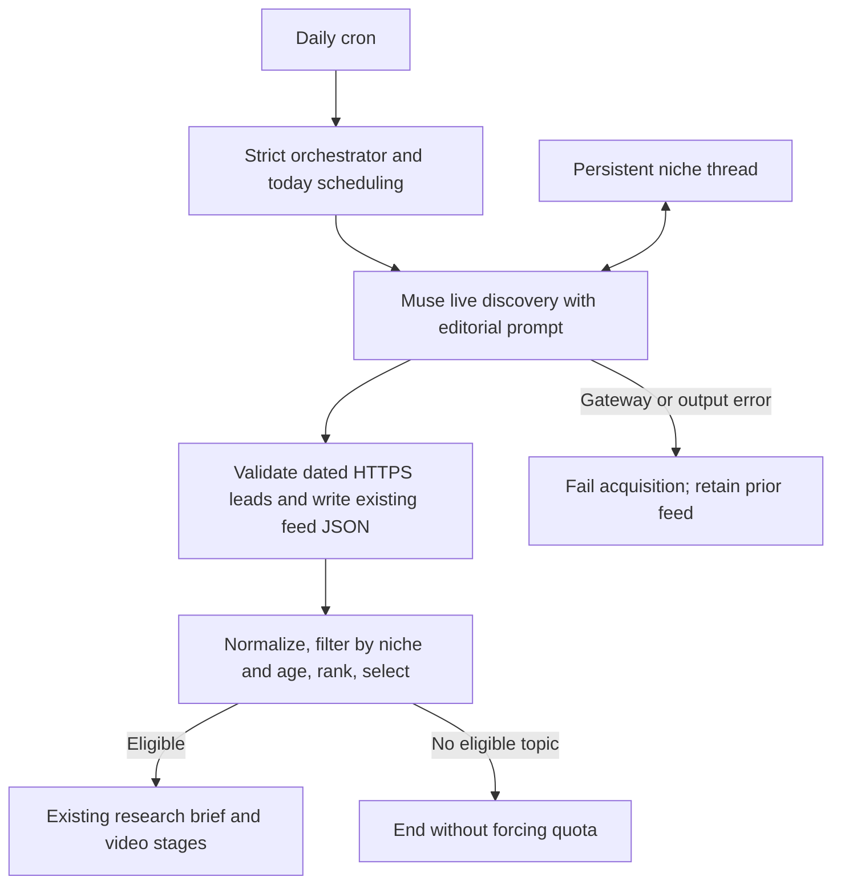

# Muse daily news discovery

The daily runner uses the Toolcase Gateway Muse chat endpoint to discover current, source-led story candidates for the owner-locked Practical AI Agent Engineering niche. It writes the same JSON array of raw news items to `data/newsnow_feed.json`; the existing adapter, scope gate, ranking, research brief, directors, evidence and release checks still apply. Muse output is a lead, not an independently captured source or approved claim.

The discovery prompt in `scripts/prompts/muse_news_discovery.prompt.md` asks for a specific developer question, an honest hook, and a claim-matched visual idea alongside a real dated primary source. The optional editorial suggestions travel in the raw item's existing `extra.editorial` object and are provided to the research selector as untrusted ideas. The resulting `research_brief.json` and video artifacts retain their existing formats.

Set `MUSE_GATEWAY_URL` to the gateway origin, `NEWS_MAX_SOURCE_AGE_HOURS` to the allowed publication age, and `MUSE_THREAD_CACHE` to a persistent writable file shared by scheduler runs. The default `data/muse_thread_cache.json` persists through restarts when the repository is bind-mounted as in `docker-compose.yml`. Never place credentials in the URL. Configure Muse authentication, source access, and any browser-action approvals on the gateway itself; HTTP 401 and 409 remain explicit failures. The client follows a dedicated niche discovery thread, serializes access to its cache, and replaces a removed thread after a 404. Each new result still has to satisfy the current freshness and niche policies; earlier thread context is not proof that a new claim is current.

Muse errors fail the acquisition instead of silently switching providers or reusing a prior feed. A valid empty result means no eligible story; it does not force a quota or change the publishing queue. To select the former daily-news gateway explicitly, set `NEWS_DISCOVERY_PROVIDER=daily-news`. This is a provider change and should be reviewed as part of deployment. `MUSE_GATEWAY_URL` is the origin (for example `http://127.0.0.1:20129`), not a `/custom/daily-news` path.

**Release limitation:** In its non-strict capture mode, the existing `scripts/bind_news_evidence.py` can build evidence files from the research brief rather than captured source bytes. Muse-provided URLs, dates, summaries, and editorial ideas are therefore not independent proof. Do not treat the integration or a passing discovery test as authorization to publish; the authentic source-capture and editorial-review workflow must be completed and validated separately before release.

For isolated verification, run the focused Muse client and discovery tests plus the news pipeline and cron tests in the prescribed server test checkout. A real Muse sample needs a configured gateway and may use model or browsing resources; it does not verify a source claim, generate a video, approve publishing, or deploy the cron change.
