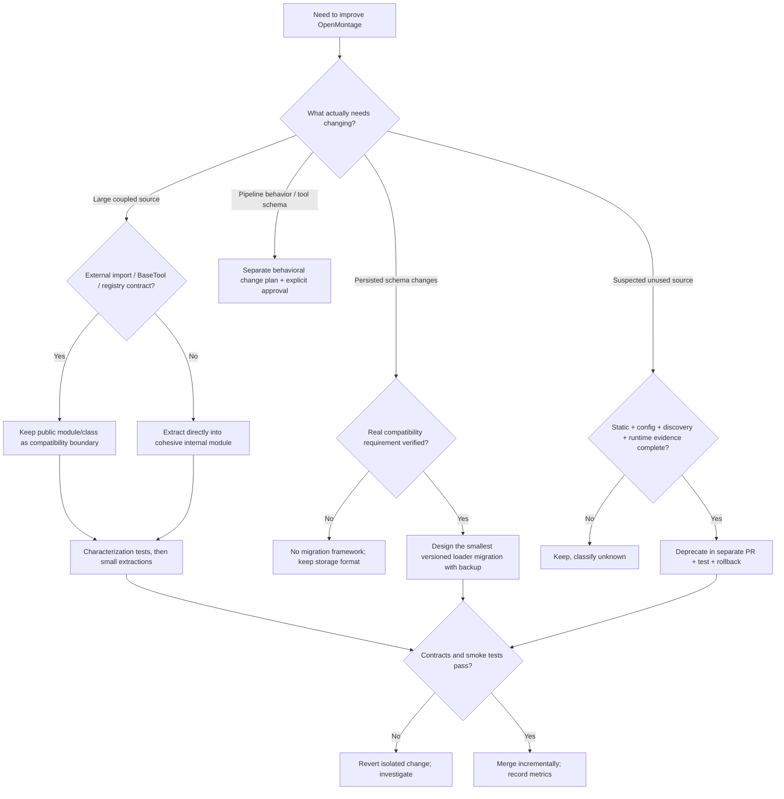

# OpenMontage — Architecture Migration & Maintainability Remediation Plan

> **Status:** COMPLETED & VERIFIED (Phases 0-6 implemented, tested, and passing)  
> **Target repository:** `giauphan/OpenMontage`  
> **Archived repository destination:** `plan/completed/OPENMONTAGE_ARCHITECTURE_MIGRATION_PLAN.md`  
> **Prepared:** 2026-10-19  
> **Priority:** Preserve production behavior and reduce maintenance cost, not rewrite the platform.  
> **Execution mode:** Incremental, contract-first, reversible, evidence-based.

---

## 0. Goal, scope, and completion contract

### Goal

Refactor OpenMontage's oversized, multi-responsibility source files into cohesive, maintainable modules, make ownership and dependency boundaries visible, and safely identify truly unused code **without changing the existing agent-driven video-production pipeline, external tool contracts, runtime selection, publication governance, or generated-artifact semantics**.

This is **architecture/source-code migration**, not automatically a database or persisted-data version migration. Introduce a persisted-data migration subsystem **only if** a specific existing state format must change and the necessity is demonstrated by a failing compatibility fixture or approved schema change.

### In scope

- Reproducible source/LOC/complexity inventory and dependency/reachability mapping.
- Contract baselines for `BaseTool`, registry discovery, YAML manifests and skill references, JSON schemas, checkpoints, render-runtime routing, and publisher safety.
- Characterization/golden-master tests before refactor.
- Small, vertical, behavior-preserving extractions behind existing Python import paths and `BaseTool` classes.
- Separate Remotion/TypeScript/Backlot modularization **only where audit measurements justify it**.
- Evidence-based source-code deprecation/cleanup, architecture CI gates, documentation/ADR updates.

### Out of scope by default

- Big-bang rewrite, microservices, new dependency-injection framework, generic event bus or DAG framework.
- A new Python stage orchestrator/reviewer/agent handler. **The AI agent remains the production control plane.**
- Changes to `pipeline_defs/*.yaml`, stage-director skills, public tool names/schemas, cost policies, render-runtime locks, approval gates, scheduling/publishing behavior, or artifact schema as a side effect of reorganizing code.
- Deleting runtime media, outputs, checkpoints, user projects, threads, or publication evidence during **source-code** cleanup.
- Auto-deleting any file solely because grep or a static import graph found no references.
- Changes to live deployment/cron or the stable server checkout without explicit authorization.

### Definition of Done (overall)

- [ ] Every refactored module has a BEFORE/AFTER LOC/complexity record and documented responsibility.
- [ ] All supported public import paths, `BaseTool` names, operation enums, input/output JSON schemas and error categories remain unchanged unless separately approved.
- [ ] Representative YAML pipeline/skill references, checkpoint data, render metadata and composition inputs remain compatible.
- [ ] `remotion`, `hyperframes`, and `ffmpeg` routing keeps explicit proposal/runtime authorization. No silent substitution on errors.
- [ ] Baseline characterization tests, contract tests and isolated end-to-end smoke checks pass with no unexplained regression.
- [ ] At least one high-value hotspot (pilot: `tools/video/video_compose.py` **if Phase 0 confirms**) is decomposed into independently testable cohesive modules without making the public module a second orchestrator.
- [ ] Existing registry discovers exactly the same tool names/metadata under equivalent test conditions; unexpected imports/registration side effects are zero.
- [ ] Every removed source path has a signed-off evidence record, deprecation window where relevant, passing tests and a one-PR revert route.
- [ ] CI prevents new large/circular modules without blocking on preexisting legacy debt.
- [ ] Rollback was actually exercised in an isolated environment; rollback is not merely described.
- [ ] No unrelated pipeline, render, publish, cron, or cleanup behavior changed.

**Success measurement:** maintainability is measured through coupling/complexity and stable contracts, not by an arbitrary mandate that every file must be shorter than 500 lines. Phase 0 supplies exact numeric baselines and assigns module-specific targets.

---

## 1. Confirmed architecture and non-negotiable constraints

The following paths and behavior were read directly from the repository at plan preparation time. Revalidate on the implementation branch because `main` may move.

| Existing path | Verified role | Change rule |
|---|---|---|
| `PROJECT_CONTEXT.md` | Agent-first architecture; YAML manifests + Markdown skills drive orchestration; Python handles tools/persistence | Preserve; use as canonical architecture contract |
| `AGENTS.md`, `AGENT_GUIDE.md` | Execution location, agent workflow, pipeline stages and approvals | Read first, obey during implementation; do not weaken |
| `pipeline_defs/` | Declarative YAML manifests | Do not rename stages/tool refs as a refactor side effect |
| `skills/pipelines/`, `skills/meta/` | Stage directors, reviewer, checkpoint protocol | Preserve reference resolution and agent behavior |
| `schemas/artifacts/`, `schemas/pipelines/` | Artifacts and manifest validation | Maintain schema compatibility |
| `lib/pipeline_loader.py` | `yaml.safe_load`, JSON Schema validation, cached read-only manifest loader | Preserve loader public functions, cache/read-only semantics |
| `tools/base_tool.py` | Canonical `BaseTool`/`ToolResult` contract | Preserve signatures and metadata contract |
| `tools/tool_registry.py` | `pkgutil.walk_packages` + `importlib.import_module` + `inspect` discovery of concrete `BaseTool` subclasses | A module with zero direct imports **may still be live**; preserve discovery |
| `tools/video/video_compose.py` | Public `VideoCompose` tool, FFmpeg/Remotion/HyperFrames composition, operation schema and runtime routing | Keep class in place; extract internals only after parity tests |
| `tools/video/hyperframes_compose.py` | HyperFrames runtime implementation | Preserve API and validation, no silent fallback |
| `tools/video/video_stitch.py` | Stitch/spatial/validation helpers | Scope separate from composition refactor |
| `remotion-composer/` | Node/React Remotion composition | Preserve composition IDs, prop shapes and render commands |
| `backlot/` | UI/server/state surface | Refactor separately only if test coverage exists |
| `scripts/check_cleanup_eligibility.py` | Fail-closed **production-project/media** cleanup, requiring published evidence | NEVER weaken, bypass or reuse as an authorization for source deletion |
| `tests/contracts/`, `tests/tools/`, `tests/qa/`, `tests/test_publish_cleanup.py` | Existing test domains | Reuse actual suites and add missing characterization tests |

**Important distinction:** `tools/video/video_compose.py` performs *technical render composition routing* as a tool. That does **not** authorize a new Python **pipeline stage orchestrator**. Do not conflate the two.

**Execution-location rule:** `AGENTS.md` requires source authoring and coding agents in the authorized **local workspace/worktree**. Server `sandbox-video` is for controlled synchronization, setup, tests/builds/renders **in an isolated test checkout**. Never edit source on the server, and do not run tests/renders against live production state. Documentation-only edits may be made locally without creating a new worktree under the current project rule.

**Source confidence:** path existence and the specific architecture contracts above were directly inspected. Exact current LOC, full call graph, historical behavior parity, and any claim that a particular file is dead code are **not yet established**. This plan intentionally makes those facts Phase 0/1 exit gates rather than assumptions.

---

## 2. `/decisiontree` — architectural decision



### Decision record: ADR-001

| Option | Compatibility | Delivery risk | Complexity/cost | Decision |
|---|---|---|---|---|
| A. Incremental capability modules with thin legacy facades | Strong | Low/medium | Moderate | **CHOSEN** |
| B. Pipeline-centric renaming/restructuring of tools and skills | Weak until all references migrate | High | Medium/high | Reject as default; use only for verified isolated internal cases |
| C. Full clean-architecture rewrite/microservices | Uncertain | Very high | Very high | Reject |
| D. Generic DB/data migration framework for source-code refactor | Mis-scoped | High | High | Reject |

**Final decision:** implement **A — contract-first incremental modularization**, starting with a pilot extraction in an actual hotspot. Optimize around capability boundaries such as composition, artifact handling and rendering, not around arbitrary line-count chunks. Use adapters/facades only where an existing public import path or dynamic registration contract must remain stable.

**Not chosen now:** a generic `migration/runner.py` domain-version kernel. If Phase 0 identifies persisted-format incompatibilities that this refactor cannot avoid, create a **separate ADR and PR** for a minimal load/save-boundary migration; otherwise do not introduce it.

### Design guardrails

1. Stable public surfaces point inward; internal code never imports its public facade (avoid cycles).
2. Prefer pure validation/planning/serialization helpers as the first extraction; isolate filesystem/subprocess/network behind explicit adapters.
3. Existing `VideoCompose(BaseTool)` remains discoverable under its existing module and tool name `video_compose`.
4. Internal modules should not define new concrete `BaseTool` subclasses, to avoid extra dynamic registrations.
5. Extract one responsibility per PR; run the contract gate before moving another.
6. Feature flags are optional, temporary and only justified for a risky behavior-preserving implementation switch. No hidden runtime engine fallback.
7. Source-code cleanup and runtime artifact cleanup are unrelated approval domains.

---

## 3. Proposed target layout (conditional, not precreated)

Only add files that Phase 0/1 prove useful. Proposed existing paths marked `[existing]`; proposed files marked `[new]`.

```text
OpenMontage/
├── PROJECT_CONTEXT.md                       [existing]
├── AGENTS.md / AGENT_GUIDE.md                [existing]
├── pipeline_defs/                            [existing, unchanged contracts]
├── skills/pipelines/                         [existing, unchanged contracts]
├── schemas/                                  [existing, unchanged contracts]
├── tools/
│   ├── base_tool.py                          [existing, public]
│   ├── tool_registry.py                      [existing, public, dynamic discovery]
│   └── video/
│       ├── video_compose.py                  [existing, remains VideoCompose entrypoint]
│       ├── hyperframes_compose.py            [existing, runtime adapter boundary]
│       ├── video_stitch.py                  [existing, separate responsibility]
│       └── _compose/                         [new only after hotspot audit]
│           ├── __init__.py                   [new]
│           ├── asset_resolution.py           [proposed pure resolver]
│           ├── runtime_policy.py             [proposed approved-runtime selection]
│           ├── ffmpeg_commands.py            [proposed command construction]
│           ├── remotion_payload.py           [proposed prop/input construction]
│           └── validation.py                 [proposed validation helpers]
├── lib/                                      [existing, shared infrastructure]
├── remotion-composer/                        [existing; refactor independently]
├── backlot/                                  [existing; refactor independently]
├── tests/
│   ├── contracts/
│   │   ├── test_video_compose_stability.py   [proposed]
│   │   ├── test_tool_registry_parity.py      [proposed]
│   │   └── test_pipeline_reference_integrity.py [proposed]
│   ├── tools/
│   │   └── test_compose_module_extracts.py  [proposed]
│   └── fixtures/architecture/               [proposed sanitized fixtures]
├── scripts/
│   └── architecture_inventory.py             [proposed, read-only audit]
├── docs/architecture/
│   ├── ADR-001-incremental-modularization.md [proposed]
│   └── module-ownership.md                   [proposed]
└── plan/pending/
    └── OPENMONTAGE_ARCHITECTURE_MIGRATION_PLAN.md  [this plan]
```

**Naming rule:** avoid creating a `video_compose/` package adjacent to `video_compose.py` because Python import resolution can become ambiguous. `_compose/` is a *suggestion*, not an instruction to move every helper before analyzing method responsibilities.

**Boundary contract for each new helper:** declare owner, accepted input/output types, side effects, allowed imports, unit tests and call site(s). Reject helpers that import the public `video_compose.py` facade or quietly select a different render engine.

---

## 4. Execution roadmap — small, reversible PRs

### Phase 0 / PR-00 — Establish a pinned, reproducible architecture baseline (P0)

**Dependencies:** None. **Behavior changes:** None. **Changes allowed:** audit scripts, docs, generated reports; no moving/deleting code.

**Tasks**

- [ ] In the authorized local checkout, read `AGENTS.md`, `AGENT_GUIDE.md`, `PROJECT_CONTEXT.md` and confirm workspace/server rules.
- [ ] Capture `git rev-parse HEAD`, `git status --short`, Python/Node versions, current dependency lockfiles and relevant test entrypoints. Treat any prior research commit hash as informational, not current HEAD.
- [ ] Generate `architecture-inventory.json`: tracked path, language, logical LOC and physical LOC, bytes, AST functions/classes, per-function length, complexity estimate where supported.
- [ ] Rank hotspots by (1) contract/public usage, (2) change frequency, (3) responsibility count, (4) test coverage, (5) LOC/complexity. Do not rank by byte size alone.
- [ ] Inventory actual `BaseTool` subclasses and exact tool names/metadata; inventory registry dynamic imports and module import side effects.
- [ ] Inventory YAML manifests, skill paths, schema refs, configured entrypoints, cron/shell scripts, Remotion composition IDs, Backlot routes, checkpoint usage, publish/cleanup controls.
- [ ] Build a **candidate-only** reachability report combining static imports, dynamic discovery, string/config/script references and known runtime entrypoints. Unresolved usage = `UNKNOWN / KEEP`.
- [ ] Select a pilot **only after** confirming the hotspot's exact function shape and available tests. Preferred candidate: `tools/video/video_compose.py`.
- [ ] Record baseline environment and known flaky tests; do not label legacy failures as refactor regressions without investigation.

**Suggested local, read-only inspection commands:**

```bash
# Run in the authorized local workspace (inspection only).
git rev-parse HEAD
git status --short
git ls-files '*.py' '*.ts' '*.tsx' '*.js' '*.jsx' '*.mjs' '*.cjs' \
  | while IFS= read -r f; do printf '%8d  %s\n' "$(wc -l < "$f")" "$f"; done \
  | sort -nr | head -80

git grep -nE 'BaseTool|pkgutil\.walk_packages|importlib\.import_module' -- tools lib tests
```

**Deliverables**

- `architecture-inventory.json` and an analyst-readable shortlist with evidence; location determined by current repo policy.
- `contract-inventory.json`: public tool API schema/name, pipeline refs, outputs, runtime approval invariants.
- `reachability-inventory.json`: `KEEP / UNKNOWN / CANDIDATE`, rationale and confidence; **no delete list certified yet**.
- Draft `ADR-001` and target pilot scope with owners and known risks.

**Exit gate:** inventory generated on one pinned commit, reviewed; no destructive changes; pilot and first pure helper extraction identified.

**Rollback:** revert audit-only PR; production behavior unaffected.

### Phase 1 / PR-01 — Freeze contracts with characterization tests (P0)

**Dependencies:** PR-00. **Behavior changes:** None. Capture pre-refactor behavior in an isolated test environment.

**Tasks**

- [ ] Snapshot `VideoCompose` tool name, version, capabilities, `input_schema`, operation enum, important defaults, `ToolResult` shape and error categories. Compare semantic structures, not incidental object order.
- [ ] Test `ToolRegistry` discovery and `get("video_compose")` without accidentally requiring unavailable provider credentials or costly render calls; separate *discovery* failures from external dependency failures.
- [ ] Create matrix for `render_runtime=remotion|hyperframes|ffmpeg`: approved path, missing tool/runtime, invalid edits, explicit refusal to fallback, proposal mismatch, missing asset and invalid output.
- [ ] Freeze manifest loader behavior: `load_pipeline`, `load_pipeline_readonly`, manifest JSON Schema validation, existing skill reference resolution including legitimate aliases.
- [ ] Verify checkpoint/artifact compatibility and golden fixtures (normalize only nondeterministic timestamps/IDs).
- [ ] Cover publisher safety with existing `tests/test_publish_cleanup.py` and fail-closed scenarios; refactor must not make unpublished assets eligible for cleanup.
- [ ] Add representative smoke fixtures for at least one animation/generated route and one footage route; run isolated non-publishing checks.
- [ ] Report unknown/broken baseline cases rather than modifying expected behavior to make tests green.

**Proposed files:** `tests/contracts/test_video_compose_stability.py`, `tests/contracts/test_tool_registry_parity.py`, `tests/contracts/test_pipeline_reference_integrity.py`, supporting sanitized fixtures. File names are *new proposals*, not existing tests.

**Required assertions**

```text
registry_name_before == registry_name_after
registry_tool_schema_before == registry_tool_schema_after
operation_enum_before == operation_enum_after
selected_runtime == proposal_approved_runtime
missing_runtime -> explicit blocker, not silent fallback
same input -> same normalized composition intermediate artifacts
same invalid input -> same public error category
all published-evidence cleanup checks remain fail-closed
```

**Exit gate:** contract test suite fails meaningfully on deliberately altered public contract, but passes against the original implementation in isolated test checkout.

**Rollback:** remove tests/fixtures if incorrect; never weaken a production contract to satisfy a faulty snapshot.

### Phase 2 / PR-02 — Pilot extraction: one pure responsibility from `video_compose.py` (P1)

**Dependencies:** PR-01 green. **Behavior changes:** None.

**Tasks**

- [ ] Inspect method-level call graph and mutable state within `VideoCompose`. First select a **pure, deterministic** extraction such as path/asset resolution, Remotion payload construction or FFmpeg command construction, **only if that responsibility is actually present and cohesive**.
- [ ] Create one private helper in `tools/video/_compose/` with explicit typed inputs/outputs; avoid passing the complete `VideoCompose` instance where a small value object suffices.
- [ ] Keep all existing public tool entrypoints, method signatures, `BaseTool` metadata, operation names and import paths in `tools/video/video_compose.py`.
- [ ] Delegate one old code path to the new helper; avoid cross-cutting redesign or new provider selection rules.
- [ ] Preserve subprocess timeout, retry/resume, workspace preservation, path handling and output naming behavior.
- [ ] Run unit tests, public contract tests, manifest/registry tests, and render smoke if the extraction touches render inputs.
- [ ] Capture BEFORE/AFTER normalized intermediate outputs, LOC/coupling changes and any performance regression.

**Exit gate:** first extracted module is independently testable; original module still owns its public boundary; all observed behavior and metadata remain equivalent.

**Rollback:** one PR revert restores original implementation; no persisted state migration.

### Phase 3 / PR-03..PR-05 — Complete composition-domain modularization (P1)

**Dependencies:** pilot proven safe. **Behavior changes:** None.

One cohesive extraction per PR, conditional on measured code responsibilities:

| PR | Candidate concern | Entry/exit boundary | Regression requirement |
|---|---|---|---|
| PR-03 | Asset resolution and input validation | Public `VideoCompose` -> pure helpers | Missing files, URI/path decoding, asset ID mapping, structured errors |
| PR-04 | Approved runtime policy and payload/command preparation | Keep `render_runtime` governance inside existing public tool behavior | All 3 runtime routes, forbidden fallback, atelier mode |
| PR-05 | Renderer-specific technical helpers | Existing adapters for Remotion/HyperFrames/FFmpeg | Output contracts, timeout behavior, no provider substitution |

**Special care:** Remotion `composition_mode="atelier"` is orthogonal to runtime; HyperFrames atelier must remain HyperFrames; FFmpeg remains FFmpeg; only approved Remotion atelier invokes the existing bespoke Remotion path. Runtime failure must produce a blocker rather than reroute.

**Exit gate:** the composition source has materially fewer unrelated responsibilities/branches and is easier to test while the class/public contract remains stable. Do not force an arbitrary LOC target if extraction would create cycles or excessive pass-through layers.

**Rollback:** revert the relevant single PR; re-run isolated render-compatibility checks before proceeding.

### Phase 4 / PR-06+ — Expand to next measured hotspots (P1/P2)

**Dependencies:** pilot and composition tests pass. **Behavior changes:** None.

Candidate audit queue (**not a verified LOC ranking**):

1. `tools/video/hyperframes_compose.py` — separate workspace materialization vs validation/render command construction if coupled.
2. `tools/video/video_stitch.py` — evaluate stitch/spatial/validation responsibilities.
3. `lib/multishot_jobs.py`, `lib/daily_news_acceptance_loop.py` — inspect job/state responsibilities and checkpoint integration.
4. `scripts/codex_agent_validation.py`, `scripts/publish_manual_video.py` — inspect large multi-concern scripts; preserve command-line interface, exit codes, idempotency and publishing safeguards.
5. `remotion-composer/src/Explainer.tsx` or other measured UI/renderer hotspots — split React scene/presentation/state logic if fixture/component tests can protect prop semantics.
6. `backlot/ui/board.js` — analyze state/UI modularity separately; no accidental endpoint or server-state contract change.

**Selection rule:** take the next item with the highest `risk-adjusted maintenance benefit`, *not* simply the longest source file. Code generated/vendor packages, fixtures, or giant static data tables may legitimately remain large or be addressed through different mechanisms.

**Exit gate per hotspot:** contract baseline, one concern extracted per PR, no import cycle, measured maintainability improvement, isolated smoke passing.

### Phase 5 / PR-cleanup-* — Evidence-based dead-code removal (P2)

**Dependencies:** Phase 0 reachability inventory + adequate test coverage for affected feature. **Behavior changes:** Intended removal only after approval.

**Rules:**

- [ ] Search static Python/TS imports AND dynamic `pkgutil`, `importlib`, plugin/registry discovery, `BaseTool` subclass registration, shell invocations, YAML/Markdown refs, `package.json` scripts, Remotion composition IDs and media/config data references.
- [ ] Classify candidates as `ACTIVE`, `UNKNOWN`, `DEPRECATED`, `SAFE-TO-REMOVE-PROPOSED`.
- [ ] Missing evidence remains `UNKNOWN`; do not delete.
- [ ] Prefer deprecation/quarantine and a separate removal PR when clients or scheduled jobs may reference old paths.
- [ ] For every candidate, attach `source path`, `static/config/build refs`, `dynamic discovery exposure`, `runtime smoke evidence`, `test cases`, `owner signoff`, `rollback commit`, and `removal date`.
- [ ] Confirm that source cleanup cannot affect runtime-generated project files, publish logs or media retention.
- [ ] Delete only in isolated, reviewable PRs; run all impacted contracts and end-to-end tests before promotion.

**Example evidence manifest** (illustrative; do not copy `pass` statuses without running tests):

```yaml
path: tools/example/legacy_helper.py
classification: SAFE-TO-REMOVE-PROPOSED
source_references: checked
config_and_skill_references: checked
dynamic_discovery: checked
runtime_usage: checked
impacting_tests: list_actual_test_identifiers
owner_approval: required
rollback: revert_single_cleanup_pr
status: awaiting_evidence
```

**Exit gate:** no deletions lacking validated evidence; zero unexpected missing-tool registrations; cleanup policy for published production artifacts unchanged.

**Rollback:** single cleanup PR revert and isolated tests. Do not restore generated production state by guessing filenames.

### Phase 6 / PR-ci-docs — Architecture fitness functions and documentation (P2)

**Dependencies:** initial successful extraction and baseline tooling.

- [ ] Add a differential LOC/complexity gate: fail for *new* extreme hotspots; warn for existing debt; do not hard-fail every preexisting 1k-line file.
- [ ] Add import-cycle test and forbidden-dependency-direction checks (`_compose/*` must not import `video_compose.py`).
- [ ] Add registry parity and manifest/skill-reference integrity checks to CI.
- [ ] Add source cleanup review template with explicit discovery/runtime evidence.
- [ ] Document module ownership and update `docs/ARCHITECTURE.md`, which may lag the current codebase.
- [ ] Track PR-by-PR metrics (below), record ADR final status and decision exceptions.

**Exit gate:** a simulated unsafe import cycle, breaking tool rename or skill-reference removal is detected by CI. Legacy exceptions are listed, time-bounded and non-growing.

**Rollback:** revert CI/docs PR if gates are faulty; never disable existing safety gates to make a refactor pass.

---

## 5. Test and acceptance matrix

**Run tests/build/render workloads according to `AGENTS.md`: on `sandbox-video` in an isolated, synchronized test checkout, never in the stable production checkout.** Read-only code inspection and source authoring remain local. Commands below are **proposed execution examples**; confirm environment and dependencies on the actual branch before invoking. None were executed to prepare this plan.

| Test family | Scope | Minimum expectation |
|---|---|---|
| Static/source inventory | Entire tracked source | Same pinned SHA, reproducible counts and explanations |
| Tool registry | Discovery and metadata | Same names, schemas, status semantics; no unexpected tool duplication |
| BaseTool contract | `VideoCompose` and affected tools | Stable signature, result fields and exceptions |
| Manifest references | All deployed manifests | YAML validates; skills/tools resolve under existing alias conventions |
| Render routing | Remotion, HyperFrames, FFmpeg | Route lock honored; error on unavailable selected runtime; no fallback |
| Composition fixtures | Input-to-intermediate | Same normalized render payload / asset references |
| Stage/checkpoint compatibility | Sample production pipelines | Stage transition, approval and artifact output unchanged |
| Publish and cleanup safety | Publishing/retention controls | Unverified publication never permits deletion |
| End-to-end smoke | Animation and footage pipelines | Working video smoke on isolated test assets, no actual publish |
| Rollback | One extracted PR and one cleanup PR | Revert and clean isolated test pass |
| Remotion (when touched) | Component props/render | Composition IDs and output contract stable |
| Backlot (when touched) | UI/server state | Identical critical interactions and endpoint contracts |

**Suggested validation commands after dependency/setup review:**

```bash
# Execute on synchronized, isolated test checkout per AGENTS.md.
python -m pytest tests/contracts -q
python -m pytest tests/tools -q
python -m pytest tests/test_publish_cleanup.py -q

# New targeted tests, once authored:
python -m pytest tests/contracts/test_video_compose_stability.py -q
python -m pytest tests/contracts/test_tool_registry_parity.py -q
python -m pytest tests/contracts/test_pipeline_reference_integrity.py -q
```

**No magic green condition:** tests can fail for environment/credential/provider reasons. Record test class, environment, SHA, fixture and cause; do not wave away a new contract failure as a preexisting flake.

**Golden-master normalization:** ignore only truly volatile timestamps, temp paths, random IDs or encoder metadata where they do not define the contract. Never normalize away render runtime, tool name, asset ID, missing-file status, approval status or required output fields.

### Per-PR merge gate

1. Affected public contract snapshot has no unapproved delta.
2. New helper has a real single responsibility and is unit-testable.
3. New internal imports do not point back to facade.
4. Existing registry loads exactly expected tools.
5. Required isolated tests pass (or failures are triaged as blockers).
6. No new execution path can bypass human approval, runtime lock or publishing safety.
7. One-PR revert works; verification artifact attached.
8. Review notes document actual files/lines changed and why the extraction is warranted.

### Numeric KPIs — establish baseline first

| KPI | Baseline | Target |
|---|---|---|
| Top 10 source hotspots (LOC and complexity) | Phase 0 measurement | Downward trend or documented accepted exceptions |
| Max distinct responsibilities per refactored hotspot | Phase 0 analysis | One clear primary capability per new module |
| Circular dependency count in modified area | Phase 0 | No increase; aim zero in new modules |
| Registry public tool set delta | Phase 1 snapshot | **0 unintended** |
| Pipeline/schema compatibility delta | Phase 1 snapshots | **0 unintended** |
| Render-runtime silent fallback incidents | Phase 1 checks | **0** |
| Critical publish/cleanup safety regressions | Existing safety tests | **0** |
| Unsupported dead-code deletion count | Cleanup evidence manifest | **0** |
| P0/P1 test regressions introduced by refactor | Baseline | **0 unresolved** |

---

## 6. Risks, mitigation, and rollback

| Risk | Severity | Detection | Mitigation / rollback |
|---|---|---|---|
| Dynamic tool discovery breaks after moving modules | Critical | Registry parity + introspection | Preserve `VideoCompose` class/path; revert extraction |
| Render runtime silently changes | Critical | Three-route policy tests, error fixture | Fail closed; rollback runtime-policy extraction |
| Pipeline YAML skill alias falsely flagged missing | High | Manifest + actual resolver validation | Interpret alias rules; don't rename refs based on folder-name guess |
| Generated assets/frames missing after refactor | High | Asset path/missing-file fixtures and isolated E2E | Preserve file/path resolution, revert specific PR |
| Cron/publish behavior accidentally changes | Critical | Dedicated existing regression suites | Exclude from scope; separate approved behavioral fix |
| Unpublished media deleted or marked eligible | Critical | `tests/test_publish_cleanup.py` | Keep cleanup governance unchanged; fail closed |
| Hidden import cycle or side effects | High | Import graph, import/discovery smoke | One concern/PR; no internal -> facade import |
| Large PR prevents bisect/revert | High | PR scope review | PRs limited by capability; separate cleanup |
| Vendor/generated code mistaken for active business logic | Medium | Provenance check and ownership | Exclude generated/vendor from manual modularization by default |
| Unnecessary persisted state migration corrupts users | Critical | Persistence dependency audit | Do not build/run domain migration without distinct evidence and ADR |
| Testing in live server corrupts state | Critical | Checkout/environment verification | Local authoring + isolated remote validation only |

### Rollback drill

1. Capture the implementation SHA and last known passing baseline.
2. In the **isolated test checkout**, revert the single extraction/cleanup PR without modifying unrelated work.
3. Re-run targeted registry, contracts and smoke tests.
4. Compare normalized golden fixtures with original baseline.
5. Record the revert SHA, execution logs and root-cause notes.
6. Promote only after owner signs off; avoid deleting temporary rollback implementation until the compatibility window ends.

For source-only refactoring, data rollback should normally be irrelevant. If a real persisted schema migration is later approved, require an **independent** backup, atomic-write, idempotency, crash/replay and restore plan.

---

## 7. Implementation agent work orders (copyable task sequence)

### Work order A — Baseline + tests

> Read `AGENTS.md`, `AGENT_GUIDE.md`, and `PROJECT_CONTEXT.md` first. Inspect the entire actual repository at a pinned commit. Implement PR-00 and PR-01 from this plan locally only. Produce LOC and dependency inventories, dynamic registry reachability analysis, public contract snapshots and tests for render runtime/approval/fail-closed behavior. Do not delete or move production code. Synchronize the exact local revision to an isolated `sandbox-video` test checkout and run the prescribed tests there. Return commit SHA, inventory findings, exact test commands/results, blockers and PR-ready diff summary. No live cron, publishing or deployment mutations.

### Work order B — First safe vertical slice

> Implement PR-02 only after PR-01 acceptance. Select one verified pure responsibility inside `tools/video/video_compose.py`. Extract to a private cohesive helper without changing `VideoCompose(BaseTool)`, dynamic registration, operation schemas, approved `render_runtime` behavior, tool outputs or error semantics. Add focused unit tests and prove parity against original fixtures and the registry snapshot. Do not modify stage orchestration/YAML/skills or introduce new `BaseTool` subclasses. Keep the change one-PR reversible; report BEFORE/AFTER measurements and isolated test results.

### Work order C — Next hotspot + evidence-based cleanup

> After approval of the pilot, process Phase 3–6 by measured maintenance value. Implement only one cohesive extraction in each PR. Treat source modules with no static imports as UNKNOWN until all dynamic imports, registry discovery, YAML/skills, CLI/shell, Remotion and runtime traces have been checked. Never delete production artifacts. Proposed deletions require a separate evidence manifest, tests, owner signoff and rollback drill. Record all deviations as ADR amendments; stop instead of compromising public contracts.

---

## 8. Fact-check status and open blockers

| Claim | Status | How to resolve |
|---|---|---|
| OpenMontage is agent-first with YAML + Markdown stage directors and `BaseTool` Python tools | **Verified from `PROJECT_CONTEXT.md`** | Revalidate at pinned implementation SHA |
| `ToolRegistry.discover()` imports modules dynamically and registers concrete BaseTool subclasses | **Verified from `tools/tool_registry.py`** | Preserve runtime discovery tests |
| `VideoCompose` is named `video_compose` and has `compose/render/remotion_render/burn_subtitles/overlay/encode` operations | **Verified from `tools/video/video_compose.py`** | Snapshot exact schemas before changes |
| Runtime selection is governed by `edit_decisions.render_runtime`; fallback without approval is forbidden | **Verified in composition module documentation/contract** | Test executable behavior with fixtures |
| Cleanup of generated project files requires authoritative publish evidence | **Verified from `scripts/check_cleanup_eligibility.py`** | Re-run safety suite |
| Exact set of files above 1000 LOC and actual highest-complexity functions | **Not yet measured locally** | Phase 0 inventory |
| All claimed unused/dead files or folders | **Not established** | Phase 0 & 5 reachability proof |
| Existing test suite is completely green | **Not established; tests not run** | Phase 1 isolated baseline |
| Database/persisted state migration framework needed | **Not established** | Keep out of scope until a real format change is proven |
| Current branch SHA equals a prior research snapshot | **Not established** | Record `git rev-parse HEAD` at execution time |

### Evidence pointers

- Repository: <https://github.com/giauphan/OpenMontage>
- Architecture: `PROJECT_CONTEXT.md`, `AGENT_GUIDE.md`, `docs/ARCHITECTURE.md`
- Tool discovery: `tools/tool_registry.py`, `tools/base_tool.py`
- Composition: `tools/video/video_compose.py`, `tools/video/hyperframes_compose.py`, `tools/video/video_stitch.py`
- Manifests and validation: `pipeline_defs/`, `lib/pipeline_loader.py`, `schemas/`
- Cleanup safety: `scripts/check_cleanup_eligibility.py`, `tests/test_publish_cleanup.py`
- Agent/server execution restrictions: `AGENTS.md`

External pattern references (architectural justification, not source-code evidence):

- Martin Fowler, *Branch by Abstraction*: <https://martinfowler.com/bliki/BranchByAbstraction.html>
- Martin Fowler, *Strangler Fig Application*: <https://martinfowler.com/bliki/StranglerFigApplication.html>

---

## 9. Final go/no-go decision

**GO** with Phase 0 and Phase 1 (read-only audit plus behavior-free test additions), followed by a small, justified pilot in the public composition tool. **GO conditionally** with later modularization where metrics and tests demonstrate benefit.

**NO-GO** on deleting/renaming public entrypoints, rewiring the agent control plane, silently switching render runtimes, relaxing publisher cleanup, installing a generic migration kernel without a documented persisted-format requirement, or performing a big-bang rewrite.

**Stop and seek a separate architecture decision** if Phase 0 reveals that the selected extraction must change public tool schemas, approval behavior, published artifact formats, persistence semantics, or production deployment. Those are feature/contract migrations, not merely safe module extraction.

**Done means tested, reversible improvements to the actual codebase**, not just a more attractive folder tree.
